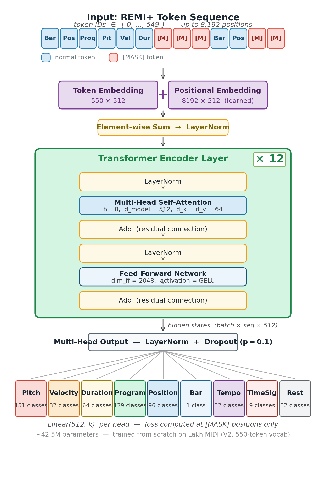

<div align="center">

# MIDIT: Multi-Track Symbolic Music Infilling via BERT-Style Pre-Training and Distribution-Aware Fine-Tuning

Simone Zanetti · MSc thesis, Data Science, University of Padova, 2025/26 · Supervisor: Prof. Antonio Rodà · Co-supervisor: Matteo Spanio

[](https://www.python.org/)
[](https://pytorch.org/)
[](https://lightning.ai/)
[](https://github.com/Natooz/MidiTok)
[](https://huggingface.co/SimoneZanetti00/MIDIT-checkpoints)
[](LICENSE)

</div>

## What it is

MIDIT is a BERT-style masked language model for symbolic multi-track music infilling: given a MIDI piece with some bars removed, it reconstructs their content from the music before **and** after the gap. It works on REMI+ tokens with a 12-layer Transformer encoder (~42.5M parameters) and nine prediction heads (Pitch and PitchDrum share one), pre-trained on 50,000 Lakh MIDI files. MIDIT is presented not as a state-of-the-art system, but as a controlled study of how masking strategy, generation paradigm, structural conditioning and evaluation methodology interact in symbolic music infilling.

## Key findings

- **Token-level pre-training does not transfer to infilling.** Cloze accuracy is high
  (average Top-1 83.18%), but used zero-shot on contiguous masked bars, pitch accuracy
  falls from 26.2% (1 bar) to 0.8% (5 bars). At a matched ~42% masking rate, Content
  Preservation is 0.966 for scattered masking vs 0.128 for contiguous bars.
- **BarFillMasking recovers infilling.** Fine-tuning with contiguous bar masking, which
  matches the inference-time task, raises 5-bar pitch accuracy from 0.8% to 33.9% and
  Content Preservation on 50 songs from 0.297 to 0.681.
- **Different quality profiles, not a ranking, vs the Anticipatory Music Transformer.**
  On 878 paired samples MIDIT preserves more of the original content (CP 0.728 vs 0.649,
  d_z = 0.33), pitch-class entropy is statistically indistinguishable (p = 0.47), and
  the autoregressive model shows higher groove consistency (0.911 vs 0.840 for MIDIT).

<p align="center">
  
</p>

## Quickstart

```bash
git clone https://github.com/SimoneZanetti00/MIDIT.git && cd MIDIT && uv sync
uv run hf download SimoneZanetti00/MIDIT-checkpoints midit-infilling-epoch05.ckpt --local-dir logs/checkpoints/
uv run python scripts/inference/infer_from_midi.py --midi_path examples/0000799e8672292fe6f0fff08554ca40.mid \
    --checkpoint logs/checkpoints/midit-infilling-epoch05.ckpt --mask_bars 3 4 5 --start_bar 12 --output_dir outputs/example/
```

Windows (PowerShell):

```powershell
uv run python scripts/inference/infer_from_midi.py --midi_path examples/0000799e8672292fe6f0fff08554ca40.mid --checkpoint logs/checkpoints/midit-infilling-epoch05.ckpt --mask_bars 3 4 5 --start_bar 12 --output_dir outputs/example/
```

Runs on CPU; writes `original.mid`, `masked.mid` and `reconstructed.mid` (details in [Quickstart](#-quickstart--infilling-on-your-own-midi) below).

## Links

[Thesis PDF — Release v1.0 (to be published)](https://github.com/SimoneZanetti00/MIDIT/releases) ·
[Checkpoints on Hugging Face](https://huggingface.co/SimoneZanetti00/MIDIT-checkpoints) ·
[Errata](docs/ERRATA.md) ·
[Cite](CITATION.cff)

---

> **Research-status note.** MIDIT's supported code paths are Phase 1 masked-language-model pre-training and Phase 1b infilling fine-tuning. The repository also preserves exploratory text-conditioning code and historical experiment material; these are not an end-to-end, supported text-to-MIDI workflow. The numerical results below are those reported in the thesis; the thesis is the authoritative reference for protocols and statistics. Hydra configs in `conf/` have drifted since the thesis runs — see [`conf/README.md`](conf/README.md) before reproducing a run.

## 🎯 What is MIDIT?

Autoregressive music models (GPT-style) generate strictly left-to-right: when filling a gap in the middle of a piece, the music *after* the gap is available and musically informative — yet ignored by design. A musician completing a phrase knows both what comes before **and** what comes after.

**MIDIT** applies bidirectional Masked Language Modeling to this problem:

- 🎼 **REMI+ tokenization** (MidiTok): multi-track MIDI as a single interleaved token stream with explicit metric structure
- 🧠 **12-layer bidirectional TransformerEncoder** (~42.5M parameters, trained from scratch on the Lakh MIDI Dataset)
- 🎯 **9 type-specific prediction heads** with a weighted multi-head loss — one head per REMI+ token type
- 🔧 **Two-phase training**: BERT-style pre-training, then **BarFillMasking** fine-tuning that aligns the training distribution with the real infilling task
- ⚡ **Single-pass parallel inference**: all masked positions predicted at once (a fraction of a second per sample vs. ~6.6 s for an autoregressive baseline)

> **Task definition.** MIDIT performs *content infilling on a given rhythmic scaffold*: structural tokens (Bar, Position, Tempo, TimeSig, Rest) are preserved, and the model predicts the musical content (Pitch, Velocity, Duration, Program) of the masked bars. It predicts **what** to play, not **when** — the "rewrite these bars" use case of a DAW workflow.

---

## 📊 Key Results

### Pre-training (Phase 1 — MLM cloze accuracy, best checkpoint `epoch=14, val_loss=2.7254`)

| Metric | Value |
|---|---|
| Avg Top-1 cloze accuracy | **83.18%** |
| Avg Top-5 cloze accuracy | **94.00%** |
| Pitch Top-1 | **84.29%** |

*Averages exclude the trivially predictable Bar (100%) and TimeSig (98.4%) types.*

### The core finding: zero-shot collapse → diagnosed → fixed

Pre-trained with 15% scattered masking, the model **collapses** on contiguous-bar infilling (pitch accuracy: 26.2% at 1 bar → **0.8%** at 5 bars). An ablation isolating masking *structure* from masking *rate* shows the cause is structural: at the **same ~42% mask rate**, Content Preservation is **0.966** (scattered) vs **0.128** (contiguous bars).

**BarFillMasking fine-tuning** (5 epochs, `infilling-epoch=05`) closes the gap:

| Masked bars | Zero-shot pitch acc. | Fine-tuned | Δ |
|---|---|---|---|
| 1 | 26.2% | 38.5% | +12.3 pp |
| 3 | 10.9% | **40.1%** | +29.2 pp |
| 5 | 0.8% | **33.9%** | **+33.1 pp** |

### Large-scale validation (50 songs, 3 masked bars)

| Model | CP ↑ | GS ↑ | PCHE ↓ |
|---|---|---|---|
| Zero-shot | 0.297 | 0.861 | 0.487 |
| **Fine-tuned** | **0.681** | **0.966** | **0.320** |

### Comparison with the Anticipatory Music Transformer

Paired comparison on **878 matched LMD samples** (masked bars 3–5, time-aligned
crop of the masked region, paired t-test; thesis Table 5.17):

| Metric | MIDIT FT | Anticipatory MT | p | d_z |
|---|---|---|---|---|
| CP ↑ | 0.728 ± 0.19 | 0.649 ± 0.23 | < 0.001 | 0.33 |
| PCHE ↓ | 0.323 ± 0.31 | 0.312 ± 0.41 | 0.47 | 0.02 |

*GS is not comparable across paradigms: MIDIT preserves Position tokens, so 93% of
its samples have GS = 1.0 by construction, while Anticipatory MT regenerates
onsets. GS is therefore not used to rank the two systems.*

**Groove consistency** (reference-free; same 878 matched samples; thesis Table 5.18):

| | MIDIT FT | Anticipatory MT |
|---|---|---|
| Groove consistency ↑ | 0.840 | 0.911 |

**JS Similarity** to the LMD reference distribution (thesis Table 5.15):

| | JS Similarity | n |
|---|---|---|
| Upper bound (ground-truth bars) | 87.90 | 989 |
| MIDIT FT | 87.93 | 989 |
| Anticipatory MT | 88.61 | 892 |

*Anticipatory MT is evaluated on a different sample set (n = 892) and is reported
for context; its JS Similarity is not directly comparable with the MIDIT rows.*

The two paradigms — bidirectional, parallel (MIDIT) vs. autoregressive
(Anticipatory MT) — show **different quality profiles** rather than a ranking:
on the paired samples, MIDIT stays closer to the original content of the masked
bars (higher CP, moderate effect), pitch-class entropy is statistically
indistinguishable, and Anticipatory MT has the higher groove consistency; on JS
Similarity, MIDIT matches the ground-truth upper bound.

### Verified genuinely generative 🔬

Inference integrity was audited mechanically: the model input contains `[MASK]` at every masked position (runtime probe: 20/20 slots), predictions come from head-wise argmax over logits only, **46–73% of Pitch tokens differ** from the ground truth with plausible in-register substitutions, and shuffling only the *context* bars changes 12/20 predictions — predictions are conditioned on musical context, mechanically excluding any copy path. See `scripts/verification/`.

---

## 🏗️ Architecture

```
Input: REMI+ token sequence (vocab 550, up to 8,192 positions), content tokens → [MASK]
  │
  ├─ Token Embedding (550 × 512) + learned Positional Embedding
  │
  ├─ 12 × TransformerEncoder layer (pre-norm)
  │     · Multi-Head Self-Attention (h = 8, d_model = 512)
  │     · Feed-Forward (dim = 2048, GELU) · dropout 0.1
  │     · no causal mask — full bidirectional attention
  │
  └─ Multi-Head Output: 9 type-specific linear heads
        Pitch · Velocity · Duration · Program · Position · Bar · Tempo · TimeSig · Rest

Loss:  L = Σₜ λₜ · (1/|Mₜ|) · Σᵢ∈Mₜ CE(yₜ⁽ⁱ⁾, ŷₜ⁽ⁱ⁾)     (per-type masked-token normalization)
```

**Tokenizer** — MidiTok REMI+ (V2 config, vocab = 550):

```python
TokenizerConfig(
    pitch_range=(21, 109),
    beat_res={(0, 4): 8, (4, 12): 4},
    num_velocities=32,
    use_programs=True,
    one_token_stream_for_programs=True,
    use_time_signatures=True,
    use_tempos=True,
    use_rests=True,
    delete_equal_successive_tempo_changes=True,
    delete_equal_successive_time_sig_changes=True,
)
```

---

## 🗃️ Dataset

| | |
|---|---|
| **Source** | [Lakh MIDI Dataset](https://colinraffel.com/projects/lmd/) (`lmd_full`, ~168k multi-track files) |
| **Training subset** | 50,000 files |
| **Quality filters** | ≥ 50 notes · ≥ 15 s duration · velocity diversity (80.3% survival) |
| **Augmentation** | pitch shifting ±5 semitones (×11 per file, drums excluded) |
| **Split** | 80/10/10 **song-level** (all transposed variants share the split — zero leakage), seed = 42 |
| **Output** | 441,518 pre-tokenized `.pt` sequences (66 GB), ~14.5M 8-bar training chunks |

---

## 📁 Repository Structure

```
MIDIT/
├── midit/                             # Python package
│   ├── model/
│   │   ├── masked_transformer.py      # Main model (Lightning module)
│   │   ├── multi_head_output.py       # 9 prediction heads + weighted loss
│   │   ├── model_factory.py           # Builds the model from the Hydra config
│   │   └── text_encoder.py            # FLAN-T5 (Phase 2, deferred — not used)
│   ├── data/
│   │   ├── lakh_dataset.py            # Dataset, chunking, song-level split, tokenizer config
│   │   └── masking.py                 # TokenLevelMasking, BarFillMasking
│   ├── loss/                          # Leftover from the project template — not used
│   ├── train_phase1.py                # Phase 1: MLM pre-training
│   ├── train_infilling.py             # Phase 1b: BarFillMasking fine-tuning
│   └── infer.py                       # Infilling inference (validation set)
├── scripts/                           # Pipelines & analyses — index in scripts/README.md
│   ├── preprocessing/                 # Lakh MIDI → REMI+ .pt dataset (preprocess_v2.py)
│   ├── inference/                     # infer_from_midi.py (any MIDI), generate_samples_batch.py
│   ├── evaluation/                    # cloze accuracy, CP / GS / PCHE, statistics
│   │   ├── js/                        # JS Similarity pipeline (M. Spanio)
│   │   ├── decoding/                  # decoding-strategy ablation
│   │   └── baselines/                 # Anticipatory MT + random-in-key baselines
│   ├── verification/                  # integrity probes, checkpoint audit, sample manifest
│   ├── analysis/                      # dataset and thesis analyses
│   └── figures/                       # figure scripts
├── conf/                              # Hydra configs — see conf/README.md (drift, checkpoints)
├── examples/                          # Two Lakh MIDI files for the quickstart (CC BY 4.0)
├── tests/                             # CPU smoke tests (uv run pytest)
├── slurm/                             # SLURM job scripts (DEI cluster, user-specific paths)
├── docs/                              # ERRATA.md, analysis/ notes, audits/ (2026-07 audit trail)
├── figures/                           # Architecture figure (thesis figures: see the PDF)
└── research/                          # Historical / V1 / exploratory scripts and
                                       #   thesis_materials/ (earlier approaches) — not maintained
```

---

## 🧭 Usage at a Glance

| Use case | Needs | Entry point | Section |
|---|---|---|---|
| **Infill bars of your own MIDI file** | a checkpoint only (CPU is enough) | `scripts/inference/infer_from_midi.py` | [Quickstart](#-quickstart--infilling-on-your-own-midi) |
| Infill held-out validation songs | checkpoint + preprocessed dataset | `midit/infer.py`, `scripts/inference/generate_samples_batch.py` | [Dataset-backed inference](#dataset-backed-inference) |
| Train Phase 1 / Phase 1b | preprocessed dataset + GPU | `midit/train_phase1.py`, `midit/train_infilling.py` | [Training](#%EF%B8%8F-training) |
| Reproduce the evaluation | generated samples (+ dataset for cloze accuracy) | `scripts/evaluation/`, `scripts/verification/` | [Evaluation](#-evaluation) |

The preprocessed dataset is not distributed (66 GB); see
[Reproducing the dataset](#-reproducing-the-dataset).

---

## ⚙️ Installation

Requires **Python 3.12** and [uv](https://github.com/astral-sh/uv).

```bash
git clone https://github.com/SimoneZanetti00/MIDIT.git
cd MIDIT
uv sync                     # add --group eval for the evaluation scripts
```

Windows: if `uv sync` fails with a hardlink / cloud-file error (e.g. under
OneDrive), run `uv sync --link-mode=copy`.

> The code state at thesis submission, before this repository reorganisation, is
> tagged `thesis-final`.

Run repository commands through `uv run` so they use the locked environment. On
Windows, this avoids shell-specific activation commands. `uv run python -m midit`
(and the `infer` console command) is an alias for `midit/infer.py`; the examples
below use the explicit scripts. See [`scripts/README.md`](scripts/README.md) for a maintained
map of the scripts, and [`research/README.md`](research/README.md) for the historical ones.

---

## 📦 Pretrained Checkpoints

Pretrained weights are hosted on the [Hugging Face Hub](https://huggingface.co/SimoneZanetti00/MIDIT-checkpoints):

| Checkpoint | Phase | Description |
|---|---|---|
| [`midit-phase1-epoch14.ckpt`](https://huggingface.co/SimoneZanetti00/MIDIT-checkpoints/resolve/main/midit-phase1-epoch14.ckpt) | Phase 1 (MLM pre-training) | base / zero-shot model, val_loss 2.7254 |
| [`midit-infilling-epoch05.ckpt`](https://huggingface.co/SimoneZanetti00/MIDIT-checkpoints/resolve/main/midit-infilling-epoch05.ckpt) | Phase 1b (BarFillMasking FT) | fine-tuned infilling model — **used for all thesis results** |

Download both into `logs/checkpoints/`:

```bash
uv pip install huggingface_hub    # or: pip install huggingface_hub

hf download SimoneZanetti00/MIDIT-checkpoints \
    midit-infilling-epoch05.ckpt midit-phase1-epoch14.ckpt \
    --local-dir logs/checkpoints/
```

Weights contain the Lightning `state_dict` + hyperparameters only (optimizer state removed). Trained on the Lakh MIDI Dataset; released for research purposes.

The warning "checkpoint produced with Lightning v2.6.0, newer than v2.5.5" on loading is harmless: the files were re-saved without optimizer state.

### Configuration and checkpoint provenance

The two checkpoints above are the thesis models; the fine-tuned model was trained
from the epoch-14 Phase-1 checkpoint. Other Phase-1 checkpoints referenced in the
repository are **not** thesis models: `epoch=49` (a later epoch of the same run,
used by the current infilling configs and a post-thesis experiment) and
`epoch=44` (invalid, from an early val_loss≈0 bug). The checkpoints' stored
hyperparameters are authoritative where they disagree with the current Hydra
configs. Details and evidence: [`conf/README.md`](conf/README.md).

The tokenizer is rebuilt in code and the `tokenizer:` section of
`conf/config.yaml` is informational; it is not the runtime source of tokenizer
settings.

---

## 🚀 Quickstart — Infilling on your own MIDI

This is the **out-of-the-box** path: it needs only the installed package and a
checkpoint. The input MIDI is tokenized on the fly — **no dataset required.**

```bash
uv run python scripts/inference/infer_from_midi.py \
    --midi_path  examples/0000799e8672292fe6f0fff08554ca40.mid \
    --checkpoint logs/checkpoints/midit-infilling-epoch05.ckpt \
    --mask_bars 3 4 5 \
    --start_bar 12 \
    --output_dir outputs/example/
```

Windows (PowerShell):

```powershell
uv run python scripts/inference/infer_from_midi.py --midi_path examples/0000799e8672292fe6f0fff08554ca40.mid --checkpoint logs/checkpoints/midit-infilling-epoch05.ckpt --mask_bars 3 4 5 --start_bar 12 --output_dir outputs/example/
```

Produces `original.mid`, `masked.mid` and `reconstructed.mid` in `--output_dir`.
Replace `--midi_path` with your own file to infill it; the two files in
[`examples/`](examples/) come from the Lakh MIDI Dataset (CC BY 4.0, attribution
in [`examples/README.md`](examples/README.md)).

> ⚠️ Unless `--skip_filters` is passed, the input MIDI must pass the same quality
> filters used in training (≥ 50 notes, ≥ 15 s, velocity diversity), otherwise the
> script exits. Inference is **deterministic** (argmax decoding): identical inputs
> produce byte-identical reconstructions across runs.

- The model sees an **8-bar window** starting at `--start_bar` (default `0`); the
  file must contain at least `start_bar + 8` bars.
- `--mask_bars` are **0-indexed within that window** (`3 4 5` = 4th–6th bar of the window).
- Runs on GPU if available, otherwise on CPU.

### Dataset-backed inference

The following reproduce the thesis evaluation on held-out validation songs and
therefore need the preprocessed `.pt` dataset (`--data_dir`). See
[Reproducing the dataset](#-reproducing-the-dataset) to build it — it is **not**
distributed (66 GB).

```bash
# Infilling on a validation-set sample (masks bars 3-5, reconstructs them)
uv run python midit/infer.py \
    --checkpoint logs/checkpoints/midit-infilling-epoch05.ckpt \
    --data_dir   data/preprocessed_v2_50k \
    --seed 5 --mask_bars 3 4 5 --output_dir outputs/demo_seed5/

# Batch generation (loads the model once, generates N samples)
uv run python scripts/inference/generate_samples_batch.py \
    --checkpoint logs/checkpoints/midit-infilling-epoch05.ckpt \
    --data_dir   data/preprocessed_v2_50k \
    --output_dir outputs/samples_1000 \
    --n_seeds 1000 --start_seed 1 --mask_bars 3 4 5
```

`--seed N` selects the N-th song of the validation split (song-level split,
seed 42; the untransposed version of each song is used). Batch generation writes
one `seed_N/` folder per sample.

---

## 🔧 Reproducing the dataset

The preprocessed dataset (441k `.pt` files, 66 GB) is **not distributed**. To
rebuild it from scratch:

1. Download the [Lakh MIDI Dataset](https://colinraffel.com/projects/lmd/)
   (`lmd_full`) and place the raw `.mid` files at **`data/midi_files/lmd_full/`**.
   This input location is currently a `DATASET_DIR` constant in
   `scripts/preprocessing/preprocess_v2.py`; it is not a command-line option.

2. Run the single-stage preprocessing pipeline (filter → tokenize → augment →
   save):

   ```bash
   uv run python scripts/preprocessing/preprocess_v2.py \
       --output_dir data/preprocessed_v2_50k \
       --num_workers 32
   ```

   Optional flags: `--max_files N` (0 = all), `--dry_run`, `--seed 42`.

> **Tokenizer note.** The MidiTok REMI+ config is rebuilt in code (see the
> `TokenizerConfig` above), never shipped as a file. The 550-token vocabulary is
> deterministic from that config, so reproducing the exact vocabulary requires
> the same config **and** a matching MidiTok version.

---

## 🏋️ Training

> ⚠️ The current defaults in `conf/` do **not** reproduce the thesis runs on their
> own (learning rate, some loss weights and the infilling base checkpoint have
> changed since). The tables below list the thesis settings; see
> [`conf/README.md`](conf/README.md) for the full comparison.

**Phase 1 — MLM pre-training** (BERT-style 15% token-level masking):

```bash
# local / configured accelerator
uv run python midit/train_phase1.py \
    chunking.preprocessed_dir=data/preprocessed_v2_50k \
    train.lr=3e-4

# Cluster-only launcher; contains DEI-specific paths and settings.
# Extra arguments are forwarded to Hydra.
sbatch slurm/train_phase_1_v3.sh train.lr=3e-4
```

| Parameter | Thesis value (Phase 1, best checkpoint) |
|---|---|
| Optimizer | AdamW, lr 3×10⁻⁴, weight decay 0.01 |
| Best checkpoint | epoch 14, val_loss 2.7254 |
| Loss weights λ | Pitch 3.0 · Velocity 1.5 · Duration 1.0 · Program 1.5 · Position 0.5 · Bar 0.0 · Tempo 1.0 · TimeSig 0.5 · Rest 1.0 |
| Precision | bf16 · gradient clipping 1.0 |
| Hardware | 1 × NVIDIA A40 48 GB *(pending verification)* |

*Optimizer settings and loss weights are the hyperparameters stored in the
released checkpoints. The stored `bar_level_masking=True` is an unused
constructor argument: masking is applied by the dataset, which used token-level
masking.*

**Phase 1b — infilling fine-tuning** (BarFillMasking: 1–3 contiguous bars, content tokens only, structure preserved):

```bash
uv run python midit/train_infilling.py \
    train.checkpoint_path=logs/checkpoints/midit-phase1-epoch14.ckpt \
    chunking.preprocessed_dir=data/preprocessed_v2_50k \
    train.lr=3e-5
```

> Always pass `train.checkpoint_path` explicitly: the default in
> `conf/config_infilling.yaml` is an absolute cluster path to the later `epoch=49`
> checkpoint, not the epoch-14 base of the thesis model.

| Parameter | Thesis value (Phase 1b) |
|---|---|
| Initialization | Phase-1 checkpoint, epoch 14 |
| Optimizer | AdamW, lr 3×10⁻⁵, cosine schedule |
| Best checkpoint | epoch 5, val_loss 8.5836 |
| Hardware | 1 × NVIDIA L40S |

> ℹ️ The infilling validation loss (~8.6) is **not comparable** to Phase 1 (~2.7): Phase 1b masks only high-entropy content tokens, while Phase 1 averages over trivially predictable structural tokens.

---

## 📏 Evaluation

> All evaluation commands below operate on the preprocessed dataset or on batch-generated samples — see [Reproducing the dataset](#-reproducing-the-dataset).

**Cloze accuracy (Top-1 / Top-5, per token type):**

```bash
uv run python scripts/evaluation/evaluate_phase1_accuracy_DIRECT.py \
    --checkpoint logs/checkpoints/midit-phase1-epoch14.ckpt \
    --data_dir   data/preprocessed_v2_50k \
    --split val --num_samples 400
```

**Infilling metrics (CP / GS / PCHE) on a results directory:**

```bash
uv run python scripts/evaluation/compute_muspy_metrics.py \
    --results_dir outputs/samples_1000 \
    --output_csv  outputs/metrics/samples_1000.csv
```

**JS Similarity pipeline** (distributional comparison vs. the LMD corpus):

```bash
# 1. reference aggregate (LMD corpus statistics)
uv run python scripts/evaluation/js/compute_reference_agg.py \
    --midi_dir data/midi_files/lmd_full/ --output_json outputs/ref_agg.json \
    --max_files 1000 --seed 42

# 2. model aggregate (masked-bar crops of the reconstructions)
uv run python scripts/evaluation/js/compute_model_agg.py \
    --samples_dir outputs/samples_1000 --output_json outputs/model_agg.json

# 3. JS score
uv run python scripts/evaluation/js/compute_js_score.py \
    --ref_agg outputs/ref_agg.json --model_agg outputs/model_agg.json
```

**Integrity & verification probes** (audit that inference cannot copy the input):

```bash
uv run python scripts/verification/check_sample_integrity.py --samples_dir outputs/samples_1000
uv run python scripts/verification/probe_no_cheat.py \
    --checkpoint logs/checkpoints/midit-infilling-epoch05.ckpt \
    --data_dir data/preprocessed_v2_50k --seed 79 --n_slots 20 --mask_bars 3 4 5
```

> **Evaluation dependencies.** `compute_muspy_metrics.py`, the JS-similarity
> utilities (`scripts/evaluation/js/`) and `scripts/evaluation/paired_stats_fixed.py` need `muspy` and
> `scipy`, declared in the optional `eval` dependency group:
> `uv sync --group eval`.

---

## 🧰 Tech Stack

| Tool | Role |
|---|---|
| [PyTorch](https://pytorch.org/) + [Lightning](https://lightning.ai/) | Model & training loop |
| [MidiTok](https://github.com/Natooz/MidiTok) | REMI+ tokenization |
| [Hydra](https://hydra.cc/) | Configuration management |
| [Weights & Biases](https://wandb.ai/) | Experiment tracking |
| [MusPy](https://github.com/salu133445/muspy) / symusic | Evaluation metrics |
| [uv](https://github.com/astral-sh/uv) | Environment management |
| SLURM | Cluster scheduling (DEI, University of Padova) |

---

## ⚠️ Known Limitations

Disclosed and quantified in the thesis:

- **Position scaffolding** — the rhythmic grid is given; MIDIT predicts content, not onsets (Option B protocol, consistent with MusicBERT)
- **Oracle token-type selection** at inference (mitigated: the type is always observable from REMI+ grammar)
- **Deterministic argmax decoding** — one completion per input; stochastic sampling is future work
- **Local 8-bar context** — no long-range song structure
- **50k / 168k files** — Pitch and Tempo learning curves still descending at the best checkpoint

**Future work:** full-dataset training with shard-based I/O · stochastic decoding · BPE ablation · Phase 2 text-conditioned infilling (MidiCaps + FLAN-T5).

---

## 📝 Notes on the thesis text

A few statements in the printed thesis need correction: some descriptions of the
training configuration differ from the released checkpoints (e.g. the
Tempo/TimeSig/Rest loss weights in Table 4.1), the GC column of Table 5.11
averaged a different set of seeds than stated in its caption, and the token labels
of the illustrative Figure 2.9 are wrong. The corrections are
listed in [`docs/ERRATA.md`](docs/ERRATA.md). All reported results are computed on
the released checkpoints; apart from the GC column of Table 5.11 and the
reference line of Figure 5.5, no reported value changes, and no conclusion changes.

---

## 📚 References

- Devlin et al., *BERT: Pre-training of Deep Bidirectional Transformers*, NAACL 2019
- Zeng et al., *MusicBERT*, ACL 2021 · Hsiao et al., *MidiBERT-Piano*, 2021
- Huang & Yang, *REMI (Pop Music Transformer)*, ACM MM 2020 · von Rütte et al., *FIGARO (REMI+)*, ICLR 2023
- Fradet et al., *MidiTok*, ISMIR 2021
- Thickstun et al., *Anticipatory Music Transformer*, 2023
- Raffel, *The Lakh MIDI Dataset*, 2016

## 🙏 Acknowledgements

Developed at the University of Padova. Cluster infrastructure based on the [DEI Blade Template](https://github.com/CSCPadova/dei-blade-template). Evaluation metric utilities (`scripts/evaluation/js/`) courtesy of PhD Matteo Spanio.

## 📄 License

[MIT](LICENSE)
